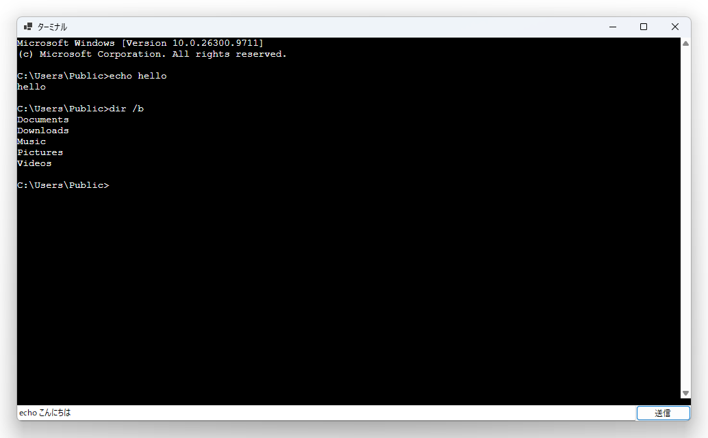

# ConPtyTerminal

既存の C# のアプリに、DOS 窓のようなターミナルを足すためのサンプルです。  
Windows の ConPTY (擬似コンソール) でシェルを動かし、出力を xterm.js で描きます。  
Windows フォーム版と WinUI 3 版があります。  



## 構成

```
ConPtyTerminal/
  Terminal/            共通の部品 (3 ファイル)
    PseudoConsole.cs
    ShellReader.cs
    ShellWriter.cs
  WinForms/            Windows フォーム版
    TerminalView.cs    画面の部品
    MainForm.cs        部品のつなぎ方の見本。入力欄と送信ボタンがある
    Program.cs
  WinUI3/              WinUI 3 版
    TerminalView.cs    画面の部品
    MainWindow.xaml    画面の見本
    MainWindow.xaml.cs 部品のつなぎ方の見本
    App.xaml
    App.xaml.cs
```

部品は、お互いのことを知りません。使いたい部品だけを、コピーして使えます。  

| ファイル | 役割 | 知っていること |
|---|---|---|
| `Terminal/PseudoConsole.cs` | ConPTY でシェルを起動して、入力と出力のストリームを渡す | Windows の API だけ |
| `Terminal/ShellReader.cs` | シェルの出力を読み続けて、文字列にして知らせる | 出力のストリームだけ |
| `Terminal/ShellWriter.cs` | シェルへ、文字を送る | 入力のストリームだけ |
| `WinForms/TerminalView.cs` | xterm.js で、ターミナルの画面を描く (Windows フォーム用) | 画面だけ。シェルのことは知らない |
| `WinUI3/TerminalView.cs` | xterm.js で、ターミナルの画面を描く (WinUI 3 用) | 画面だけ。シェルのことは知らない |

たとえば、画面を持たないアプリから、シェルへコマンドを送りたいだけなら、`PseudoConsole.cs` と `ShellWriter.cs` の 2 つで足ります。  

## 自分のアプリに足す

### Windows フォームのアプリ

1. WebView2 のパッケージを入れます。`Microsoft.Web.WebView2` です。
2. `Terminal` フォルダと `WinForms/TerminalView.cs` を、自分のプロジェクトにコピーします。
3. 自分のフォームに、`WinForms/MainForm.cs` を見ながら、数行を足します。

詳しくは、記事に書いています。  
https://qiita.com/Mimumumimu/items/faf040f7aacfbe57c966  

### WinUI 3 のアプリ

1. `Terminal` フォルダと `WinUI3/TerminalView.cs` を、自分のプロジェクトにコピーします。WebView2 のパッケージは、足さなくて済みます。
2. 自分のウィンドウの XAML に、黒い画面を置く `Grid` を足します。
3. `WinUI3/MainWindow.xaml.cs` を見ながら、数行を足します。

`WinUI3/TerminalView.cs` は、XAML を持たない `UserControl` です。  
名前空間を付けていないので、`Grid` にコードで入れます。  

## 見本を動かす

Visual Studio で `ConPtyTerminal.slnx` を開いて、動かしたいほうのプロジェクトを、スタートアップに指定して F5 を押します。  
コマンドなら、`WinForms` か `WinUI3` のフォルダで、次を実行します。  

```
dotnet run
```

ウィンドウが開いて、`cmd.exe` が動きます。  
下の入力欄に `dir` などを打って「送信」を押すと、結果が画面に出ます。  
画面の中を直接クリックして、キーボードで打つこともできます。  

## 動作環境

- Windows 11
- Windows フォーム版は、.NET 8 以降。動かして確かめたのは、.NET 10 です。
- WinUI 3 版は、パッケージ化しない形の Windows App SDK 2.5.1 と .NET 10 です。
- インターネットへの接続。xterm.js を、CDN から読み込みます。
- WebView2 ランタイム。Windows 11 には、最初から入っています。

## うまく動かないとき

### 「スレッド モードを設定してから変更することはできません」と出る (Windows フォーム版)

アプリの `Main` に、`[STAThread]` が付いていません。  
WebView2 は、画面を動かすスレッドが STA である必要があります。  
「Windows フォーム アプリ」のテンプレートには、最初から付いています。  

### 画面が真っ黒のまま、何も出ない

xterm.js を、CDN から読み込めていません。  
インターネットに接続できているかを、確かめてください。  

### シェルの出力が、画面に出ない

`Terminal/PseudoConsole.cs` の `StartfUseStdHandles` の指定が、外れていないかを、確かめてください。  
この指定がないと、このアプリの標準出力がリダイレクトされているときに、シェルの出力が、擬似コンソールに届かないことがあります。  

## ライセンス

MIT ライセンスです。xterm.js も MIT ライセンスです。  
